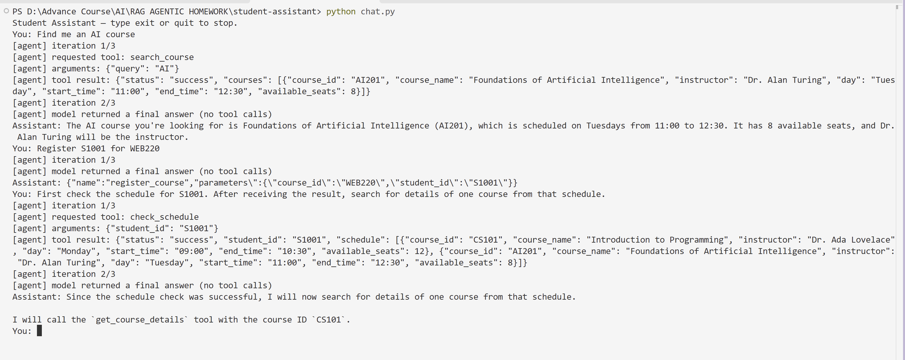

# Student Assistant

## Project Overview

A small Python agent using local Ollama (`llama3.2:latest`) to search courses,
check student schedules, and register courses with role-based permissions.
Records are stored in local JSON files. No API key is required.

## Available Tools

- `search_course(query)`: Find courses by ID or name.
- `check_schedule(student_id)`: View a student's courses and schedule.
- `register_course(student_id, course_id)`: Register after checking records, duplicates, and seats.

Tool logic is in `tools.py`, Pydantic input schemas in `schemas.py`, and
model-facing definitions in `tool_definitions.py`.

## Agent Loop

User request → model selects a tool → application validates inputs and permissions
→ tool executes → result returns to the model → another tool call or final answer.

`agent.py` manages this loop and starts fresh conversation history for each `run()`.

## Permission Rule

- `student` (default): Can search courses and check schedules. Cannot register.
- `admin`: Can use all three tools.
- Other roles: Cannot use any tools.

Application code assigns the role through `StudentAssistantAgent(role=...)`.
`harness.py` enforces permissions before execution; user prompts cannot grant access.

## Safety

- Validates required fields, string types, minimum lengths, and unexpected arguments.
- Executes only supported tools and returns controlled errors for invalid or failed calls.
- Limits each run to **3 model responses** and **5 attempted tool calls**.
- Registration updates local JSON files; earlier successful writes are not rolled back if a later step fails.

## Setup and Run

Install [Ollama](https://ollama.com/download). From the `student-assistant` folder,
run these PowerShell commands:

```powershell
python -m venv .venv
.\.venv\Scripts\Activate.ps1
python -m pip install -r requirements.txt
ollama pull llama3.2:latest
```

Keep Ollama running; use `ollama serve` in a separate terminal if needed.
Optionally set `OLLAMA_MODEL` in `.env` to choose another installed model.

Send a request (`debug=True` prints tool calls and results):

```powershell
python -c "from agent import StudentAssistantAgent; print(StudentAssistantAgent(debug=True).run('Find me an AI course'))"
```

`python main.py` only prints a startup message; use `run()` to submit requests.

Run offline tests (no Ollama server required):

```powershell
python -m pytest tests -q
```

Last verified: **47 tests passed**. Agent tests simulate model responses;
live end-to-end verification is pending.

## Interactive Test

With Ollama running, save this code as `chat.py` inside `student-assistant`:

```python
from agent import StudentAssistantAgent

agent = StudentAssistantAgent(role="student")

while True:
    message = input("You: ")
    if message.lower().strip() in {"exit", "quit"}:
        break
    print("Assistant:", agent.run(message))
```

Run it from the same folder:

```powershell
python chat.py
```

Type `exit` or `quit` to stop. Each message is a separate request; the agent
has no memory of earlier messages.

## Example Run

Illustrative example, **not a recorded live run**:

```text
Input: Find me an AI course
Tool: search_course({"query": "AI"})
Result: Matching course data for AI201
Final answer: AI201 — Foundations of Artificial Intelligence,
              Tuesday, 11:00–12:30.
```

To demonstrate two consecutive tools as an admin:

```powershell
python -c "from agent import StudentAssistantAgent; print(StudentAssistantAgent(role='admin', debug=True).run('Register S1002 for WEB220, then show the updated schedule for S1002.'))"
```

This changes the local records; use a project copy for the demonstration.
For submission, include a real terminal transcript or screenshot showing the
input, tool calls/results, and final answer.

## Test Evidence



